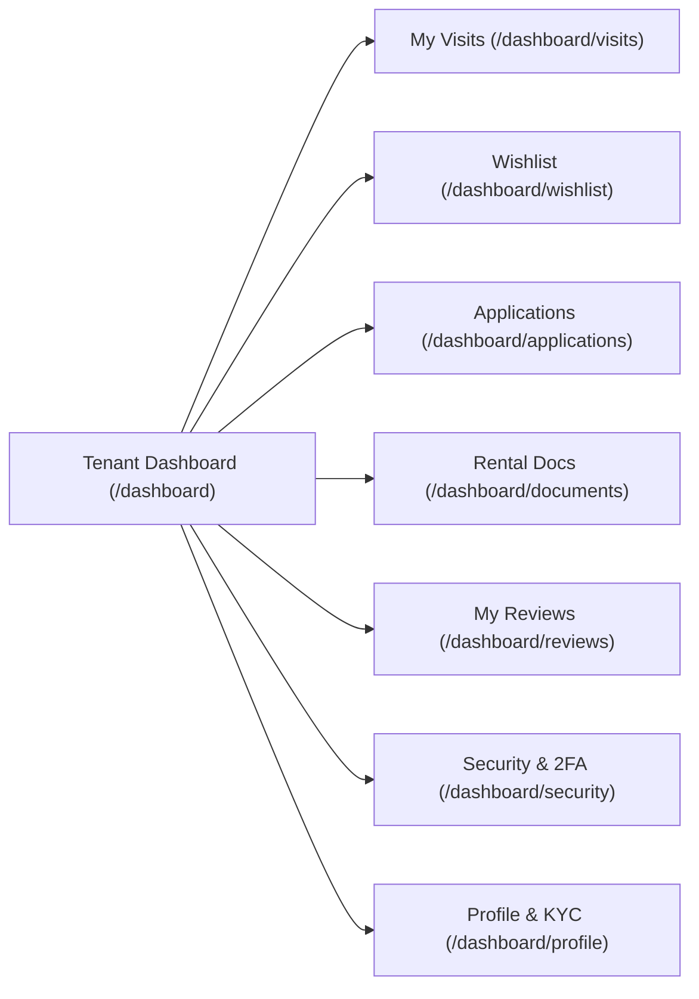
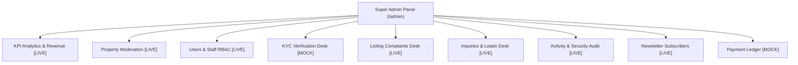

# Comprehensive Feature Matrix — PrimeHomeKanpur

---

## 1. Public Marketplace & Tenant Discovery

### 1.1 Homepage & Hero Discovery Engine
- **Unified Multi-Filter Search Bar**:
  - Locality Selector (Kakadeo, Swaroop Nagar, Civil Lines, Kalyanpur, Gurudev Chauraha, Barra, Kidwai Nagar, Vikas Nagar, Awas Vikas, etc.).
  - BHK Filter (1 BHK, 2 BHK, 3 BHK, 4+ BHK).
  - Price Bracket Selector (Under ₹10k, ₹10k–₹20k, ₹20k–₹30k, Above ₹30k).
  - Tenant Preference (Family, Bachelor, Professional, Any).
- **Locality Marquee Showcase**: Continuous hardware-accelerated marquee displaying Kanpur's top localities with active listing counts and one-click filtering.
- **Animated Performance Counters**: Live statistical counters (Verified Reviews, Years Experience, Rentals Listed, Satisfaction Rate).
- **Featured Listings Showcase**: Dynamic grid of curated, physically verified rental properties with badge overlays.
- **3D Squircle Services Grid**: Interactive cards detailing Physical Verification, Zero-Brokerage options, Legal Agreements, and Move-In Support.

### 1.2 Rentals Marketplace (`/rentals`)
- **Real-Time Client & Server Search**: Multi-faceted filter with live URL state synchronization (`/rentals?location=Kakadeo&bhk=2&price=10k-20k`).
- **Sorting Mechanisms**: Sort by Newest, Price (Low to High), Price (High to Low), and Verified Score.
- **Interactive Map / Locality Hubs**: Regional landing hubs for specific neighborhoods with commute times and neighborhood ratings.

### 1.3 Property Detail Experience (`/rentals/[slug]`)
- **High-Definition Media Viewer**: Multi-image gallery with responsive grid, thumbnail strip, lightbox modal, and video walkthrough support.
- **Key Specifications**: Monthly Rent, Security Deposit, Maintenance Charges, Floor Level, Carpet Area, Furnishing Status, Facing Direction, Available Date.
- **Verified Badges**: Green physical verification stamp, owner-direct verification marker, and agent credential tags.
- **Amenity Matrix**: Grouped badges for Power Backup, Car Parking, 24/7 Water, Lift, High Security/CCTV, WiFi, Modular Kitchen, Balcony, etc.
- **Instant Booking Engine**:
  - Physical On-Site Visit scheduler with date picker, preferred morning/evening time slots, and special requests.
  - Virtual Video Tour scheduling option.
- **Direct Owner / Agent Contact**: One-tap WhatsApp chat and phone call buttons with pre-filled property reference codes.
- **Report Listing Modal**: Community safety tool allowing tenants to flag outdated info, incorrect pricing, or fraudulent behavior.
- **Tenant Review Module**: Star rating breakdown, verified renter badge, review submission with text feedback.

---

## 2. Authenticated Tenant Dashboard (`/dashboard`)

- **Overview Hub**: Quick view of upcoming visits, active tenancy applications, and saved properties.
- **Visit Tracking (`/dashboard/visits`)** `[LIVE]`: Direct PostgreSQL query to `property_visits` table with status badges (`Pending`, `Confirmed`, `Completed`, `Cancelled`).
- **Saved Wishlist (`/dashboard/wishlist`)** `[LIVE]`: Real database synchronization of bookmarked properties with quick remove and direct visit booking.
- **My Reviews (`/dashboard/reviews`)** `[LIVE]`: Direct query to `reviews` table with moderation status (`Published`, `In Review`, `Rejected`).
- **Profile Management (`/dashboard/profile`, `/dashboard/security`)** `[LIVE]`: Direct Supabase profile updates and password reset capabilities.
- **Rental Applications (`/dashboard/applications`)** `[MOCK STUB]`: Currently renders hardcoded sample state (`app-101`). No backend `applications` table or submission form on property pages.
- **Document Locker (`/dashboard/documents`)** `[MOCK STUB]`: Simulated upload with `setTimeout` and hardcoded masked sample documents. Real encrypted bucket storage is deferred to Phase 2.
- **Notification Center (`/dashboard/notifications`)** `[MOCK STUB]`: Static sample alerts. No database table or notification engine.

---

## 3. Landlord & Property Owner Portal (`/landlord`)

### 3.1 Overview & Cashflow Analytics (`/landlord`) `[MOCK STUB]`
- **KPI Metrics**: Hardcoded counters for Active Listings, Leads, Visits, and Rental Cashflow.
- **Recent Leads Table**: Hardcoded mock inquiries; not tied to authenticated landlord properties.

### 3.2 Property Onboarding & Listing Management (`/landlord/properties`) `[MOCK STUB]`
- **Creation Form (`/landlord/properties/new`)**: Interactive UI exists, but submission executes a client-side `setTimeout` simulation rather than inserting into Supabase `properties`.
- **Listing Status Manager**: Displays static mock property cards (`Gurudev Chauraha 2BHK`).

### 3.3 Leads, Inquiries & Visits (`/landlord/leads`, `/landlord/visits`) `[MOCK STUB]`
- **Tenant Lead Inbox & Appointment Manager**: Displays sample tenant inquiries and visit requests in local state.

### 3.4 Payments & Documents (`/landlord/payments`, `/landlord/documents`) `[MOCK STUB]`
- **Payment Ledger**: Static mock records of brokerage settlements and rent receipts.
- **Document Vault**: Unbound `<input type="file">` without upload handler.

---

## 4. Admin Super-Panel (`/admin`)

- **Executive Analytics (`/admin`)** `[LIVE]`: Real-time KPI counts powered by Supabase RPC and table aggregations.
- **Property Moderation (`/admin/properties`)** `[LIVE]`: Functional CRUD operations, publish/unpublish toggles, and deletion with cascading foreign keys.
- **Inquiries Desk (`/admin/inquiries`)** `[LIVE]`: Live management of contact and rental inquiry records.
- **Review Moderation (`/admin/reviews`)** `[LIVE]`: Approve or reject submitted user reviews with real-time database updates.
- **Locality Manager (`/admin/locations`)** `[LIVE]`: Create and edit Kanpur locality hubs directly in PostgreSQL.
- **Users & Team RBAC (`/admin/users`, `/admin/team`)** `[LIVE]`: Manage user profiles and granular staff role delegations (`OWNER`, `MANAGER`, `EDITOR`, `SUPPORT`).
- **Reports & Safety Center (`/admin/reports`)** `[LIVE]`: Live intake of user-flagged property violations.
- **Activity & Security Audit Trail (`/admin/activity`)** `[LIVE]`: Queryable audit log backed by `activity_logs` table.
- **Verification Desk (`/admin/documents`, `/admin/verifications`)** `[MOCK STUB]`: Mock document inspection with browser `alert()` popups.
- **Payment Ledger (`/admin/payments`)** `[MOCK STUB]`: Static transaction table; not synced with Razorpay or database.

---

## 5. Security & Legal Infrastructure
- **Cookie Consent Banner (`CookieConsentBanner.tsx`)** `[LIVE]`: GDPR & Indian Digital Personal Data Protection (DPDP) compliant cookie banner with customizable preferences.
- **Comprehensive Legal Suite** `[LIVE]`:
  - Privacy Policy (`/privacy-policy`)
  - Terms of Service (`/terms`)
  - Refund Policy (`/refund-policy`)
  - Verification & Safety Policy (`/verification-policy`)
  - Disclaimer (`/disclaimer`)
- **Rate Limiting Engine (`rateLimit.ts`)** `[LIVE]`: In-memory token bucket rate limiting on sensitive API endpoints (Contact, Newsletter, Report, Payments).
- **Physical Lease Assistance** `[OFFLINE SERVICE]`: On-ground assisted drafting of standard 11-month tenancy agreements and Kanpur Nagar police verification support. (Digital in-browser e-signatures and stamp duty automation are deferred to future phases pending legal compliance).

